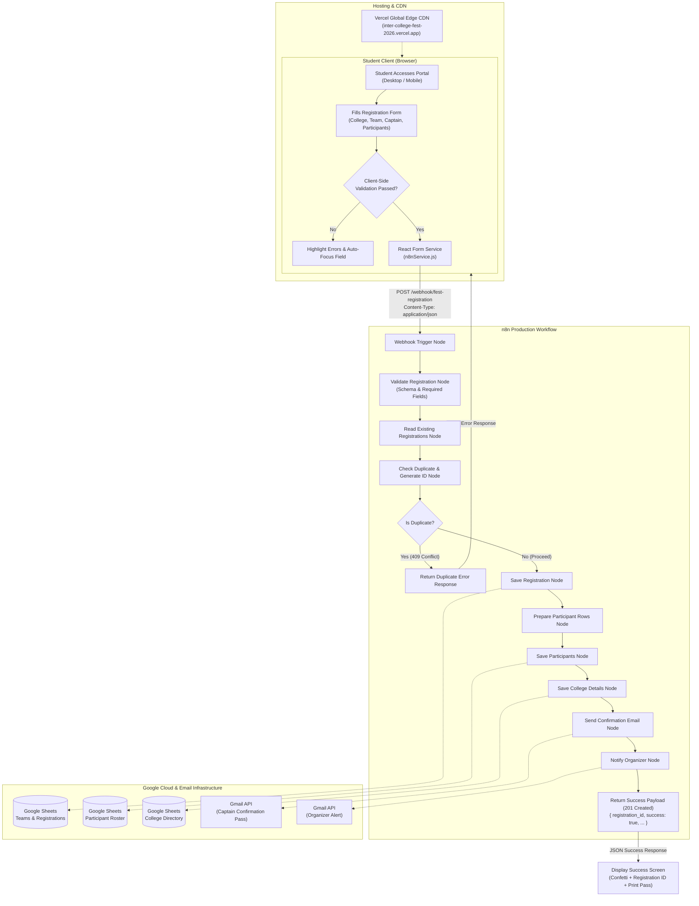

# 🎓 Inter-College Fest 2026 — Registration Portal

[](https://inter-college-fest-2026.vercel.app)
[](https://react.dev/)
[](https://vitejs.dev/)
[](https://tailwindcss.com/)
[](https://n8n.io/)
[](https://sheets.google.com/)
[](https://mail.google.com/)

A modern, responsive, national-level college festival registration platform. Built with **React**, **Vite**, and **Tailwind CSS**, this frontend integrates seamlessly with an **n8n automation backend**, **Google Sheets**, and **Gmail** to deliver an automated, serverless registration pipeline for student delegations nationwide.

---

## 📌 Table of Contents

- [1. Project Introduction](#1-project-introduction)
  - [What is Inter-College Fest 2026?](#what-is-inter-college-fest-2026)
  - [Why Was This Project Developed?](#why-was-this-project-developed)
  - [Problem It Solves](#problem-it-solves)
  - [Who Can Use This Portal?](#who-can-use-this-portal)
- [2. Project Overview & Registration Lifecycle](#2-project-overview--registration-lifecycle)
- [3. Key Implemented Features](#3-key-implemented-features)
- [4. Technology Stack](#4-technology-stack)
- [5. System Architecture](#5-system-architecture)
- [6. How to Use the Portal (Student Guide)](#6-how-to-use-the-portal-student-guide)
- [7. Registration Data Structure](#7-registration-data-structure)
- [8. Installation & Local Development](#8-installation--local-development)
- [9. n8n Automation Workflow Deep Dive](#9-n8n-automation-workflow-deep-dive)
- [10. Deployment Guide (Vercel)](#10-deployment-guide-vercel)
- [11. Project Directory Structure](#11-project-directory-structure)
- [12. Error Handling & Troubleshooting](#12-error-handling--troubleshooting)
- [13. Future Enhancements](#13-future-enhancements)
- [14. Author & Developer Credits](#14-author--developer-credits)

---

## 1. Project Introduction

### What is Inter-College Fest 2026?
**Inter-College Fest 2026** is a national-level collegiate competition portal created to celebrate student innovation, technical problem-solving, and intellectual curiosity. It brings together competitive student delegations from colleges and universities across the country to participate in flagship tracks such as the **CodeQuest Hackathon** and the **TechnoQ Quiz**.

### Why Was This Project Developed?
Traditional college festival registrations often rely on manual Google Forms, scattered email threads, or paper entries. This approach leads to common failure points:
- Duplicate team submissions and conflicting team names.
- Manual entry errors in spreadsheets.
- Long delays in sending confirmation passes to student captains.
- High administrative workload for student organizing committees.

This project was built to replace fragile manual workflows with a unified, modern web portal powered by event-driven automation.

### Problem It Solves
- **Eliminates Manual Data Entry**: Registration data flows directly from the web client into an automated pipeline that validates, catalogs, and logs entries in real time.
- **Instant Digital Passes**: Teams immediately receive a unique, system-generated Registration ID upon valid submission.
- **Automated Dual Notifications**: Captains receive instant confirmation emails with registration details, while festival organizers receive administrative alerts.
- **Accurate Squad Roster Scaling**: Allows teams to dynamically scale squad sizes (1 to 5 members) while strictly enforcing captain designation and contact verification.

### Who Can Use This Portal?
- **Student Participants**: College students, coders, and quizzers registering individual or multi-member squads.
- **Team Captains**: Lead student representatives designated as primary contacts for event logistics and email passes.
- **Fest Organizing Committee**: Event administrators reviewing incoming team rosters, capacity, and college delegations in Google Sheets.

---

## 2. Project Overview & Registration Lifecycle

The registration process follows a synchronized 13-step pipeline:

```
[Student Browser]                      [n8n Automation Engine]                     [Cloud Services]
       │                                         │                                        │
  1-6. Form Input & Validation                   │                                        │
       │                                         │                                        │
  7.   POST JSON Payload ───────────────────────►│                                        │
       │                                         │                                        │
       │                                    8.   Validate Submission                      │
       │                                    9.   Read & Check Duplicates                  │
       │                                    10.  Generate Registration ID                 │
       │                                    11.  Write Registration ─────────────────────►│ Google Sheets
       │                                    12.  Dispatch Captain Email ─────────────────►│ Gmail (Captain)
       │                                    13.  Dispatch Organizer Alert ───────────────►│ Gmail (Organizers)
       │                                         │                                        │
       │◄────────────────────────────────────────┘                                        │
  Response: 201 Created (Registration ID & Statuses)                                      │
  Success Screen + Confetti + Print Pass
```

1. **Visit Portal**: Student navigates to the live portal at `https://inter-college-fest-2026.vercel.app`.
2. **College Information**: Student enters their college/university name and official institution code (e.g., `NIT01`, `COL01`).
3. **Team & Captain Profile**: Student enters the official team name and captain contact details (name, email, phone).
4. **Dynamic Squad Roster**: Student chooses squad size (1 to 5 members). The form dynamically scales participant fields, with Captain assigned as Participant #1.
5. **Event Track Selection**: Student selects competitive tracks (Hackathon, Quiz, or both).
6. **Client-Side Validation**: Form performs real-time constraints check (RFC email validation, 10-digit phone check, required field completion).
7. **Production Webhook POST**: React dispatches the sanitized JSON payload via the Fetch API to the n8n production webhook.
8. **n8n Payload Validation**: The n8n engine checks payload integrity and confirms required fields are populated.
9. **Duplicate Detection**: The workflow checks existing entries in the database to prevent duplicate registrations for the same team/captain.
10. **Unique ID Generation**: A unique, formatted registration ID (e.g., `FEST-2026-0007`) is generated.
11. **Google Sheets Storage**: Registration details, college metadata, and individual participant rows are appended to Google Sheets.
12. **Captain Confirmation Email**: Gmail triggers a branded confirmation email containing the Registration ID and event details to the captain.
13. **Organizer Notification**: A notification email is dispatched to the festival committee for internal tracking.

---

## 3. Key Implemented Features

### 🖥️ Frontend & UI/UX
- **National Fest Design Theme**: Dark navy and deep purple background palette (`#080c14`, `#110e2e`) with electric blue and violet glowing accents.
- **Glassmorphism Components**: Modern backdrop-filter glass panels (`backdrop-blur-md`) with glowing border highlights.
- **Mobile Responsive Navigation**: Sticky glass header with brand logo, smooth-scrolling anchors, and animated mobile drawer menu.
- **Flagship Track Showcase**: Interactive cards for **CodeQuest Hackathon** and **TechnoQ Quiz** with direct event pre-selection buttons.
- **Form Completion Progress Bar**: Visual progress indicator reflecting completion percentage in real time.
- **Safe Reset Feature**: Clear-and-reset form control with user confirmation protection.

### 📝 Dynamic Form & Validation
- **Dynamic Participant Scaling**: Dynamically expands and contracts participant fields (1 to 5 members) without losing captain synchronization.
- **Captain Auto-Sync**: The captain's details are automatically synchronized with Participant #1 (designated as Primary Contact).
- **Comprehensive Frontend Constraints**:
  - RFC 5322 regex email validation.
  - 10+ digit telephone input validation.
  - Non-empty validation on institutional name and code.
  - Verification that member count strictly matches participant records.
  - Enforced selection of at least one event.
- **Accidental Resubmission Lock**: Disables submission buttons and displays an animated spinner during network transit.
- **Accessible Error Routing**: Real-time error messages linked with `aria-invalid` and `aria-describedby`, with auto-scroll and auto-focus to the first invalid field upon submission.

### ⚡ Automation & Backend Integration
- **Direct Production Webhook**: Zero intermediate backend servers needed; calls the production n8n webhook directly via POST request.
- **Duplicate Registration Handling**: Gracefully detects duplicate entries from n8n and displays a targeted alert without wiping user input.
- **Live Response Handling**: Consumes live response payload (`registration_id`, `college`, `team`, `events`, `confirmation_email`, `organizer_notification`).
- **Interactive Success Pass**:
  - Canvas confetti celebration animation.
  - Prominent display of the official Registration ID with a 1-click **Copy to Clipboard** button.
  - Built-in **Print / Save Registration Slip** feature powered by custom `@media print` CSS.
  - "Register Another Team" and "Return to Home" routing controls.

---

## 4. Technology Stack

| Technology | Category | Purpose in Project |
| :--- | :--- | :--- |
| **React 18** (`18.3.1`) | Frontend Library | Component-based UI architecture, state management, and declarative DOM updates. |
| **Vite** (`6.1.1`) | Build Tool / Bundler | Next-generation frontend tooling providing lightning-fast HMR and optimized production builds. |
| **JavaScript (ES6+)** | Programming Language | Core client-side application logic, payload formatting, and asynchronous API calls. |
| **Tailwind CSS** (`3.4.17`) | Utility-First CSS | Custom dark-theme styling, glassmorphism utilities, layout grids, and animations. |
| **Lucide React** (`0.475.0`) | Iconography System | Accessible, clean, lightweight SVG icons across navigation, form fields, and event badges. |
| **Canvas Confetti** (`1.9.4`) | UI Feedback | Interactive confetti burst effect triggered upon successful registration confirmation. |
| **Fetch API** | Networking | Native browser API for issuing asynchronous HTTP POST requests to the n8n webhook. |
| **n8n Cloud** | Automation Engine | Low-code/orchestrated workflow executing validation, ID generation, Sheets logging, and email triggers. |
| **Google Sheets** | Cloud Database | Tabular storage serving as the persistence layer for registered colleges, teams, and participants. |
| **Gmail API** | Mail Service | Automated email dispatch for captain confirmation passes and organizer alerts. |
| **Vercel** | Cloud Deployment | Serverless static hosting platform providing global CDN delivery and automatic Git-driven CI/CD. |
| **Git & GitHub** | Version Control | Source code versioning, collaboration, and deployment trigger integration. |

---

## 5. System Architecture

The following diagram illustrates how the React frontend, n8n automation backend, Google Sheets database, and Gmail communication nodes interact:



---

## 6. How to Use the Portal (Student Guide)

Follow these steps to register your team for Inter-College Fest 2026:

1. **Access the Portal**: Open [https://inter-college-fest-2026.vercel.app](https://inter-college-fest-2026.vercel.app) in any modern web browser.
2. **Explore Event Tracks**: Review rules, team sizes, and highlights in the **Flagship Events** section (Hackathon or Quiz). Click "Register for Track" to jump directly to the form.
3. **Fill College Information**: Enter your official College/University Name and your institutional College Code (e.g., `COL01`, `NIT05`).
4. **Set Up Team Identity**: Enter your unique Team Name and select your total Squad Size (from 1 to 5 members).
5. **Designate Team Captain**: Enter the Captain's Full Name, Email Address, and WhatsApp/Phone Number. The captain acts as the primary point of contact.
6. **Add Squad Members**: If your squad has more than 1 member, fill in the Name, Email, and Phone Number for each dynamic participant field.
7. **Choose Events**: Check the boxes for the tracks your squad is participating in (**Hackathon**, **Quiz**, or both).
8. **Submit Registration**: Click **Submit Official Registration**. The form will lock during transmission to prevent duplicate clicks.
9. **Receive Your Registration ID**: Upon completion, you will see a success confirmation pass displaying your official **Registration ID** (e.g., `FEST-2026-0007`).
10. **Print or Copy Your Pass**: Click **Copy Registration ID** to store your ID, or click **Print Registration Slip** to print or save a PDF pass.
11. **Check Captain's Inbox**: A confirmation email containing your Registration ID, registered events, and team details is dispatched directly to the captain's email.

### What Happens on a Duplicate Registration?
If a team with the same name, college code, or captain email is already registered, the n8n automation rejects the duplicate submission. The web page will display an amber **Duplicate Registration Detected** notification, explaining that the team is already logged and advising the captain to check their inbox. Your entered form data is retained so you can correct details without retyping.

---

## 7. Registration Data Structure

The frontend sends a structured JSON payload to the n8n production webhook via `POST`:

### Realistic Sample Payload
```json
{
  "college_name": "National Institute of Technology, Trichy",
  "college_code": "NITT01",
  "team_name": "CyberKnights",
  "captain_name": "Alex Johnson",
  "captain_email": "alex.johnson@example.edu",
  "member_count": 2,
  "participants": [
    {
      "name": "Alex Johnson",
      "email": "alex.johnson@example.edu",
      "phone": "+919876543210"
    },
    {
      "name": "Priya Sharma",
      "email": "priya.sharma@example.edu",
      "phone": "+919876543211"
    }
  ],
  "events": [
    "Hackathon",
    "Quiz"
  ]
}
```

### Field Definitions

| Field Name | Type | Required | Description | Validation Rules |
| :--- | :--- | :--- | :--- | :--- |
| `college_name` | String | Yes | Full official institution name | Cannot be empty or whitespace |
| `college_code` | String | Yes | Institutional identifier | Alphanumeric, converted to uppercase (e.g., `NITT01`) |
| `team_name` | String | Yes | Name of the competing squad | Unique per institution track |
| `captain_name` | String | Yes | Full name of team captain | Matches `participants[0].name` |
| `captain_email` | String | Yes | Primary email of captain | RFC 5322 regex format, normalized to lowercase |
| `member_count` | Number | Yes | Total count of squad members | Integer between `1` and `5` |
| `participants` | Array | Yes | List of participant objects | Length must strictly equal `member_count` |
| `participants[i].name` | String | Yes | Full name of participant | Cannot be empty |
| `participants[i].email` | String | Yes | Direct email of participant | Valid email syntax |
| `participants[i].phone` | String | Yes | Direct phone of participant | Cleaned digit string, at least 10 digits |
| `events` | Array | Yes | Selected competitive tracks | Non-empty array (contains `"Hackathon"` and/or `"Quiz"`) |

---

## 8. Installation & Local Development

### Prerequisites
- **Node.js**: v18.0.0 or later (v20+ recommended)
- **npm**: v9.0.0 or later
- **Git**: Installed and configured on your system

### 1. Clone the Repository
```bash
git clone https://github.com/harshadsr28-wq/inter-college-fest-2026.git
cd inter-college-fest-2026
```

### 2. Install Dependencies
```bash
npm install
```

### 3. Configure Environment Variables
Create a local `.env` file in the project root:
```bash
cp .env.example .env
```
Ensure your `.env` contains the production n8n webhook URL:
```env
VITE_N8N_WEBHOOK_URL=https://harshad03.app.n8n.cloud/webhook/fest-registration
```

> [!CAUTION]
> **Security Notice**: Never commit `.env` or `.env.local` files to Git. The project's `.gitignore` is pre-configured to exclude private environment files. Only generic templates (`.env.example`) should be committed.

### 4. Run the Development Server
```bash
npm run dev
```
Open [http://localhost:5173](http://localhost:5173) in your browser to view the application with hot module reloading.

### 5. Build for Production
To verify that the production build compiles with zero errors:
```bash
npm run build
```
Compiled static assets are generated in the `dist/` directory.

---

## 9. n8n Automation Workflow Deep Dive

The backend automation is hosted on **n8n Cloud** (`https://harshad03.app.n8n.cloud/webhook/fest-registration`). It orchestrates data validation, database persistence, and communication without requiring a dedicated custom backend server.

### Node Architecture & Responsibilities

1. **Registration Webhook Node**:
   - **Type**: Webhook Trigger (`POST`)
   - **Endpoint**: `/webhook/fest-registration`
   - **Behavior**: Listens for incoming registration payloads from the web frontend and extracts headers and body data.
2. **Validate Registration Node**:
   - **Type**: Code / Function
   - **Behavior**: Asserts that `college_name`, `team_name`, `captain_email`, `member_count`, and `participants` meet required constraints.
3. **Read Existing Registrations Node**:
   - **Type**: Google Sheets (Read Rows)
   - **Behavior**: Queries the primary registrations sheet to pull all active registrations for duplicate checks.
4. **Check Duplicate and Generate ID Node**:
   - **Type**: Code / Function
   - **Behavior**: Evaluates incoming data against existing records to detect conflicts (identical team names or captain emails). If unique, it calculates the next incremental sequence and formats the ID (e.g., `FEST-2026-0007`).
5. **Is Duplicate? Node**:
   - **Type**: IF / Switch
   - **Behavior**: Branches execution. If a duplicate exists, it routes directly to an error response (`409 Conflict`). If unique, it proceeds to database logging.
6. **Save Registration Node**:
   - **Type**: Google Sheets (Append Row)
   - **Behavior**: Writes the primary record (Registration ID, College Name, College Code, Team Name, Member Count, Events, Timestamp) to the master sheet.
7. **Prepare Participant Rows Node**:
   - **Type**: Code / Data Transformer
   - **Behavior**: Flattens the nested `participants` array into discrete individual rows associated with the master `registration_id`.
8. **Save Participants Node**:
   - **Type**: Google Sheets (Append Multiple Rows)
   - **Behavior**: Appends all participant records (Name, Email, Phone, Role) to the participants database tab.
9. **Save College Details Node**:
   - **Type**: Google Sheets (Append/Upsert Row)
   - **Behavior**: Catalogs institutional participation metrics, tracking the volume of teams representing each college code.
10. **Send Confirmation Email Node**:
    - **Type**: Gmail Node
    - **Behavior**: Dispatches an HTML-formatted confirmation pass to `captain_email` with event rules, track schedules, and their Registration ID.
11. **Notify Organizer Node**:
    - **Type**: Gmail Node
    - **Behavior**: Dispatches an internal briefing notification to the festival executive committee alert inbox.

---

## 10. Deployment Guide (Vercel)

The frontend is deployed to **Vercel** with full client-side routing support and automated Git-driven deployments.

### Vercel Project Settings

| Configuration Option | Setting Value |
| :--- | :--- |
| **Framework Preset** | `Vite` |
| **Build Command** | `npm run build` |
| **Output Directory** | `dist` |
| **Install Command** | `npm install` |
| **Production Domain** | `https://inter-college-fest-2026.vercel.app` |

### Client-Side SPA Rewrites
To ensure deep links and refreshed routes resolve properly without 404 errors, [vercel.json](vercel.json) configures single-page application rewrites:
```json
{
  "framework": "vite",
  "buildCommand": "npm run build",
  "outputDirectory": "dist",
  "rewrites": [
    {
      "source": "/(.*)",
      "destination": "/index.html"
    }
  ]
}
```

### Environment Variable in Vercel
In your Vercel Dashboard under **Project Settings $\rightarrow$ Environment Variables**:
- **Name**: `VITE_N8N_WEBHOOK_URL`
- **Value**: `https://harshad03.app.n8n.cloud/webhook/fest-registration`
- **Environments**: Production, Preview, Development

### Automatic Continuous Deployment (CI/CD)
Whenever code is committed and pushed to the `main` branch of `harshadsr28-wq/inter-college-fest-2026`, Vercel automatically detects the push, runs the cloud build on Linux workers, and deploys the update with zero downtime.

> [!IMPORTANT]
> **n8n Production Workflow Status**: For registrations to process successfully, the n8n workflow on `harshad03.app.n8n.cloud` must be toggled to **Active** (Production mode). If the workflow is deactivated, the webhook will return HTTP 404/503.

---

## 11. Project Directory Structure

```text
inter-college-fest-2026/
├── .env.example                  # Template showing required environment variables
├── .gitignore                    # Prevents node_modules, dist, and private .env files from Git
├── index.html                    # Root HTML document with typography & metadata
├── package.json                  # Project dependencies and npm execution scripts
├── package-lock.json             # Pinned dependency lockfile
├── postcss.config.js             # PostCSS processing configuration
├── tailwind.config.js            # Custom theme colors, gradients, and font families
├── vercel.json                   # Vercel SPA routing and build configuration
├── vite.config.js                # Vite build and development server configuration
├── README.md                     # Official project documentation
├── public/
│   └── _redirects                # Netlify SPA redirect rules fallback
└── src/
    ├── App.jsx                   # Master view orchestrator (Landing vs. Success Pass views)
    ├── main.jsx                  # React DOM entry point
    ├── index.css                 # Global CSS rules, custom scrollbars, and print stylesheets
    ├── services/
    │   └── n8nService.js         # Production n8n API client, payload sanitizer & error handler
    └── components/
        ├── Navbar.jsx            # Fixed navigation bar with mobile drawer
        ├── Hero.jsx              # Main hero banner with fest title, badges & stats
        ├── About.jsx             # 4 pillars of the fest & logistics notice board
        ├── Events.jsx            # Hackathon and Quiz competitive track cards
        ├── RegistrationProcess.jsx # 4-step registration guide
        ├── RegistrationForm.jsx  # Multi-section dynamic form with live validation
        ├── ParticipantFields.jsx # Dynamic participant fields component
        ├── SuccessScreen.jsx     # Post-submission confirmation pass screen (Confetti & Print)
        └── Footer.jsx            # Fest Organizing Committee footer & developer credit
```

---

## 12. Error Handling & Troubleshooting

| Issue / Symptom | Probable Cause | Recommended Resolution |
| :--- | :--- | :--- |
| **"Failed to fetch" / Network Error** | n8n Cloud webhook is unreachable, network is offline, or CORS preflight failed. | Verify that the n8n workflow is toggled to **Active**. Confirm your internet connection. Check that the Webhook node has CORS set to `*`. |
| **"Duplicate Registration Detected"** | A team with the same name, college code, or captain email is already recorded. | Teams cannot register twice for the same track. Check the captain's inbox for the original confirmation pass, or use a distinct team identifier. |
| **"Please enter a valid email address"** | Email address failed standard RFC 5322 regex checks. | Ensure email contains valid characters, `@` symbol, and a top-level domain (e.g., `student@college.edu`). |
| **"Phone number must contain at least 10 valid digits"** | Phone input contains fewer than 10 numeric characters. | Enter a valid 10-digit mobile number (e.g., `9876543210` or `+919876543210`). |
| **Confirmation email not received** | Email landed in Spam folder or captain's mail quota is full. | Check Spam/Promotions folder. Confirm the captain email entered during registration had no typos. |
| **Vercel build fails with missing module** | Local dependency was not saved to `package.json`. | Run `npm install <package> --save`, test locally with `npm run build`, and push updated `package.json` to GitHub. |
| **Vercel route shows 404 on refresh** | Client-side router rewrite missing. | Verify that [vercel.json](vercel.json) contains the rewrite rule pointing `/(.*)` to `/index.html`. |

---

## 13. Future Enhancements

The following improvements are planned for upcoming iterations of the portal:

- [ ] **Admin Analytics Dashboard**: Real-time visualization of registration volume by state, college, and event track.
- [ ] **Automated PDF Ticket Generator**: Server-side generation of branded PDF admission badges featuring dynamic QR codes for venue check-in.
- [ ] **Integrated Payment Gateway**: Razorpay/Stripe integration for events requiring participation or kit fees.
- [ ] **College Ambassador Referral Codes**: Tracking college representative performance with dedicated registration codes.
- [ ] **SMS / WhatsApp Alert Dispatch**: Instant WhatsApp ticket delivery via Twilio or WhatsApp Business API.
- [ ] **Role-Based Volunteer Scanner App**: Progressive Web App (PWA) allowing event volunteers to scan team QR passes at the entrance.

---

## 14. Author & Developer Credits

Designed and developed by **S R Harshad**.

- **LinkedIn**: [https://www.linkedin.com/in/harshad-sr-99685238b/](https://www.linkedin.com/in/harshad-sr-99685238b/)
- **GitHub**: [https://github.com/harshadsr28-wq](https://github.com/harshadsr28-wq)
- **Project Repository**: [https://github.com/harshadsr28-wq/inter-college-fest-2026](https://github.com/harshadsr28-wq/inter-college-fest-2026)
- **Live Website**: [https://inter-college-fest-2026.vercel.app](https://inter-college-fest-2026.vercel.app)

---

## 📄 License & Fair Use
This project is open-source and intended for academic, collegiate festival, and portfolio demonstration purposes. All rights reserved by the **Inter-College Fest 2026 Organizing Committee**.
